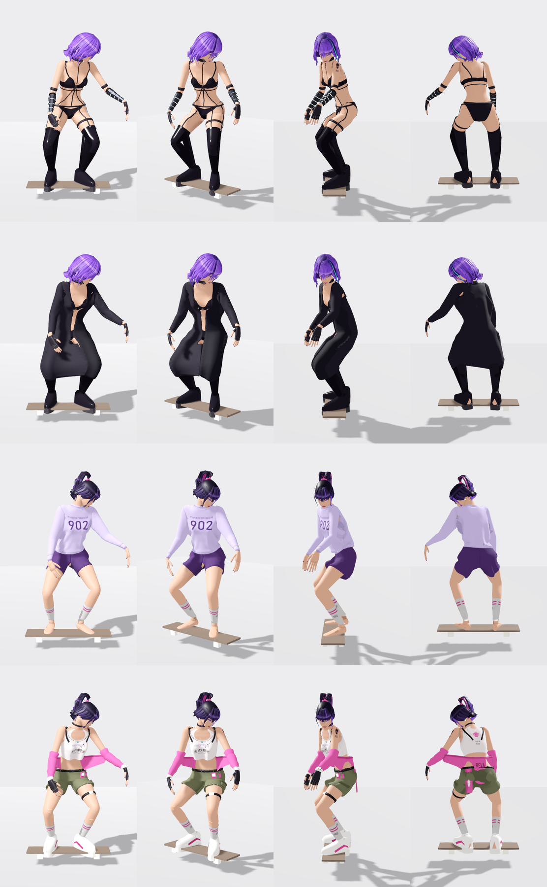

# A character ready to play in Godot 4

A character's folder is ONE `.glb` (body, texture, rig, the skate moves on its own skeleton, the board) plus its
`.import` and a README. Each was made from a rigged model.
Hair physics: `ClubHair.attach(instance)` (`club_hair.gd`). An outfit: `ClubWardrobe.attach(instance, "<outfit>")` (`club_wardrobe.gd`).

## [R.E.V.A. 902, with her wardrobe](reva902/README.md)

