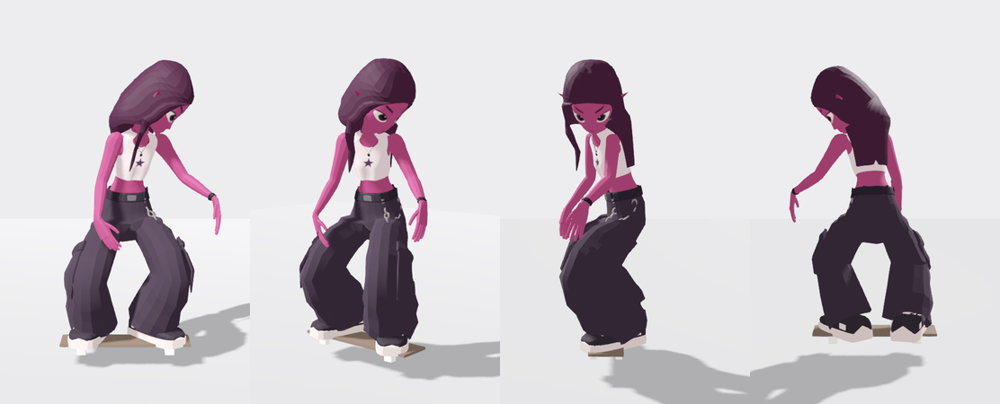

# Characters -- ready to play in Godot 4

Each folder is ONE `.glb` (body, texture, rig, the skate moves on its own skeleton, the board) plus its
`.import` and a README. Shipped by `skate_src/author/ship_character.py` in the studio repo.
Hair physics for any of them: `ClubHair.attach(instance)` (`club_hair.gd`).

## [CLANKER — the studio's robot, ready for Godot 4](clanker/README.md)

## [X3D -- the skater girl, ready for Godot 4](x3d/README.md)

