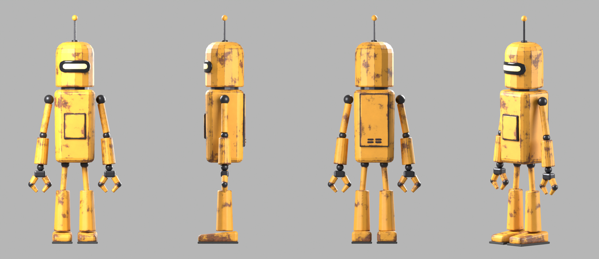
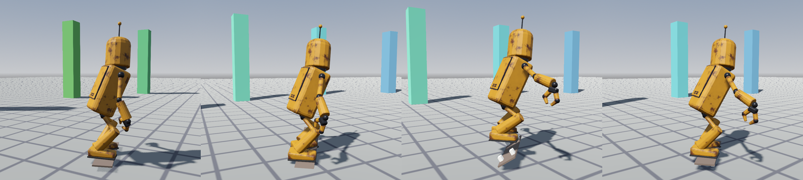

# CLANKER — the studio's robot, ready for Godot 4



One file, **`clanker.glb`**: his body (15,400 vertices, one 2048² rust texture, five materials — painted
steel, dark metal joints, the visor, its glow, rubber soles), a 32-bone Mixamo-named skeleton, and our
**14 skate moves already on his skeleton**, with the skateboard animated per trick. Nothing to retarget:
put it in a project and play `z_rm_sk_ride`.



*In Godot 4.7.2 — `demo/main.gd`, which he now stars in (open `godot/` and press F5): he rides the ring and
throws a trick every 2.5 s (pop, kickflip, shove-it, manual, grab, method). Here: riding, the crouch, the
kickflip — the board rolls under him — and the landing.*

## Use it

1. Copy `clanker.glb` **and `clanker.glb.import`** into your project (the `.import` carries the settings
   below). Godot extracts his texture beside it on import (`clanker_basecolor_0.png`) — that copy is
   rebuilt from the `.glb`, so repaint it there only if you mean to keep your own.
2. ⛔ **Godot's animation optimizer is ON by default and it is a setting of the `AnimationPlayer` NODE**
   (*Advanced Import Settings* → select `AnimationPlayer` → *Optimizer* → off), not of each animation. On,
   it drops keys it judges redundant — his ride kept 40 of its 62 hip keys — and every joint drifts 1–3 mm
   from the authored pose. Off (this `.import`), every joint and the board match the engine to 3 µm.
3. Instance him and play **`z_rm_sk_ride`** (loop): he rides in place on the board. Move the ROOT along your
   path with the board's nose (+X) pointing along the travel, so he stands sideways to it, as a skater does
   (`demo/main.gd` → `_put()`).
4. **A trick is a one-shot that starts and ends in the riding stance:** `ap.play("z_rm_sk_kf")` then
   `ap.queue("z_rm_sk_ride")`. The tricks: `pop` (ollie), `kf` (kickflip), `shove` (shove-it), `manual`,
   `grab` (indy), `method`, `push`; and `carry` / `catchup` / `dropin` / `stepoff` / `bail` / `film` (riding
   with the camera arm out — he can be the filmer). Each is described, with how it is meant to be played, in
   `godot/ANIMATION_IMPORT.md` → *The moves*.
5. **The board** is the `skateboard` node, a sibling of the skeleton animated in his own space: origin = the
   centre of the deck's top, +X = the nose, +Y = the deck's up. Parent a real board under it and hide the
   generated deck.

## What he is

- **1.72 m** to the antenna tip, hips 0.61 m; metres, Y up, facing +Z.
- **Bones:** `Hips Spine Spine1 Spine2 Neck Head Antenna1 Antenna2`, and per side `Shoulder Arm ForeArm Hand
  HandIndex1 HandIndex2 HandThumb1 HandThumb2` (the pincer claw) `UpLeg Leg Foot ToeBase`. Every part is
  RIGID on one bone — a hard-surface robot does not bend.
- His bone names follow Mixamo's — the convention Godot's humanoid `BoneMap` auto-mapping looks for — so
  other humanoid moves can be retargeted onto him. Check the map it proposes: each claw is a two-joint index
  finger and thumb, with no middle, ring or little finger.

## How he was made — all code, all reproducible

| step | tool |
|---|---|
| model, rig, rust texture, turnaround | `skate_src/robot/build_robot.py` — Blender 5.1 headless, one command: 53 primitives shaped by numbers measured off jacob's character sheet (1 px = 2.375 mm), a Mixamo-named rig, rust baked as layers and composited at an exact coverage (`--rust-cover 18`) |
| into the club engine | `python skate_src/glb2rpack_anim.py clanker.glb reva_native/packs/v1_clanker.rpack --keepnames` |
| the skate moves onto him | `python skate_src/author/retarget_skate.py <reva's moves>.rpack v1_clanker.rpack` — the moves were authored on reva: limbs by their absolute pose through the canonical rig, the trunk by its movement from rest, the head TURNS but keeps a quarter of its tilt (a robot does not cock a cylinder), the hips' travel scaled by his leg length (0.605 of hers), and each trick's board re-derived under HIS feet |
| this file | `python skate_src/author/rpack2gltf.py v1_clanker.rpack clanker.glb --clips "z_rm_sk_*" --board --mesh --materials-from <build dir>/clanker.glb` (the materials matched to the pack's meshes by geometry, not by order — the baker reorders them) |

```bash
blender --background --factory-startup --python-exit-code 1 --python skate_src/robot/build_robot.py -- --out out/clanker
```

**Verified.** Blender re-read this file: every joint of all 14 moves within 2 µm of the pack, and all
15,400 vertices within 3 µm of the club engine's own skinning (at rest, and at the start, middle and end of
every move) — `godot/verify_export_blender.py`. In Godot 4.7.2 every joint and the board within 3 µm at
seven frames of six moves (`demo/check_pose.gd -- file=clanker all=1`), and a full frame of the kickflip
looked at. A rebuild reproduces his geometry, normals, weights and rig bit for bit; its UV packing comes
out differently each run, and the rendered turnarounds do not change (0.00% of pixels apart).

## Not yet

- The **hoverboard** from his sheet (cyan thrusters) — he rides the skateboard for now.
- The sheet's differences: a taller dome, shoulder sockets, bigger claws, rounder toes.
- The antenna does not spring (its bones are there: `Antenna1`/`Antenna2`).
