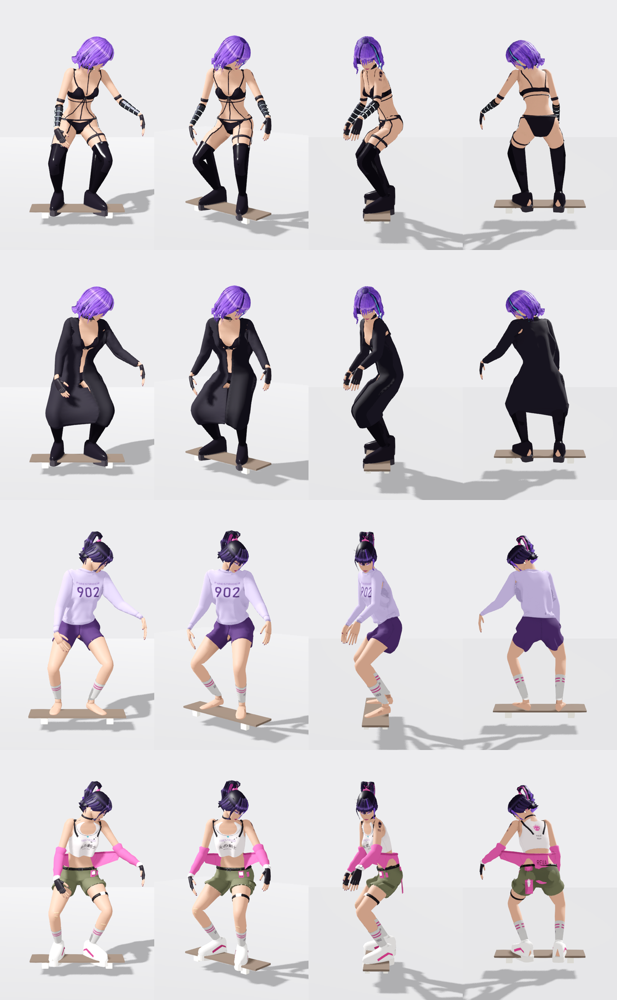

# R.E.V.A. 902, with her wardrobe

R.E.V.A. (Retro-Experimental Virtual Assistant) -- an android, built by code from her character sheets. Her clothes are MODULAR: every piece is its own mesh, four outfits so far -- base (the holographic sheet's look), street (a printed tank, cargo shorts, the pink bomber off her shoulders), sleepy (an oversized lavender 902 sweatshirt finished with rib bands, plum sleep shorts on an elastic waistband, her 902 socks) and coat (a long black coat, open over her base look). The last two were drafted from her own measurements the way real patterns are, and SEWN onto her by the engine's sewing machine (skate_src/atelier/sewing.py, drafting.py). Her hair, her jacket and her bandana swing on physics chains; her breasts spring like soft mass.

One file, **`reva902.glb`**: its body (92,795 vertices, 102,614 triangles, 1 texture; materials
`M_Hair`, `M_Fabric`, `M_Fabric`, `M_Hair`, `M_Fabric`, `M_Leather`, `M_Fabric`, `M_Fabric`, `M_Fabric`, `M_Latex`, `M_Skin`, `M_Skin`, `M_Metal`, `M_Skin`, `M_Leather`, `M_Latex`, `M_Fabric`, `M_Latex`, `M_Fabric`, `M_Leather`, `M_Plastic`, `M_Latex`, `M_Skin`, `M_Skin`, `M_Glow`, `M_Fabric`, `M_Metal`, `M_Metal`, `M_Leather`, `M_Latex`, `M_Leather`, `M_Skin`, `M_Skin`, `M_Latex`, `M_Rubber`, `M_Metal`, `M_Skin`, `M_Rubber`, `M_Skin`, `M_Metal`, `M_Fabric`, `M_Fabric`, `M_Metal`, `M_Skin`, `M_Leather`, `M_Leather`, `M_Skin`, `M_Leather`, `M_Metal`, `M_Metal`, `M_Glow`, `M_Skin`, `M_Plastic`, `M_Latex`, `M_Skin`, `M_Skin`, `M_Skin`, `M_Skin`, `M_Skin`, `M_Skin`, `M_Skin`, `M_Skin`, `M_Skin`, `M_Fabric`, `M_Glow`, `M_Metal`, `M_Plastic`, `M_Fabric`, `M_Glow`, `M_Skin`, `M_Skin`, `M_Skin`, `M_Skin`), a 108-bone Mixamo-named skeleton, and our **14 skate moves already on its own skeleton**, with the
skateboard animated per trick. Nothing to retarget: put it in a project and play `z_rm_sk_ride`. It carries 18 physics chains (`Hair_Back_C1..3`, `Hair_Back_L1..3`, `Hair_Back_R1..3`, `Hair_Pony_C1..3`, `Hair_Pony_L1..3`, `Hair_Pony_R1..3`, `Hair_Side_L1..3`, `Hair_Side_R1..3`, `Cloth_Jacket_E1..3`, `BreastL.._tip`, `Cloth_Jacket_A1..3`, `BreastR.._tip`, `Cloth_Jacket_B1..3`, `Cloth_Jacket_C1..3`, `Cloth_Jacket_D1..3`, `Cloth_Bandana_A1..3`, `Cloth_Bandana_B1..3`, `Cloth_Bandana_C1..3`): the engine swings them, and in Godot one line does -- `ClubHair.attach(instance)` (`godot/characters/club_hair.gd`: hair swings, `Cloth_*` panels hang heavier, `breast` bones spring back like soft mass).

## Its wardrobe

Every piece of clothing (and each hairstyle) is its own mesh on the one skeleton, tagged in its name -- `wear~<slot>~<piece>~<outfits>`, and `skin~h=<pieces>` for the skin those pieces cover (hidden while one is worn: nothing pokes through, nothing is missing without it). Built by the engine's tailor (`skate_src/atelier/atelier.py`; the design: `design/atelier.md`).

| outfit | pieces (slot) |
|---|---|
| **base** | `shag` (hair), `harness` (harness), `bra_latex` (bra), `bracers_tech` (arms), `stockings_latex` (legs), `briefs` (briefs), `heels_platform` (shoes), `gloves` (hands), `choker_studded` (neck), `earrings` (ears) |
| **coat** | `shag` (hair), `coat` (outer), `bra_latex` (bra), `stockings_latex` (legs), `briefs` (briefs), `heels_platform` (shoes), `gloves` (hands), `choker_studded` (neck), `earrings` (ears) |
| **sleepy** | `sweat` (top), `pony` (hair), `sleepshorts` (bottom), `socks` (legs), `earrings` (ears) |
| **street** | `pony` (hair), `tank` (top), `sportsbra` (bra), `shorts` (bottom), `socks` (legs), `briefs` (briefs), `jacket` (outer), `belt` (belt), `watch` (wrists), `sneakers` (shoes), `choker_street` (neck), `strap_902` (thigh), `gloves` (hands), `belt_gear` (belt_gear), `bandaids` (decals), `earrings` (ears), `bandana` (hip) |

## Use it

1. Copy `reva902.glb` **and `reva902.glb.import`** into your project (the `.import` carries the settings below).
2. ⛔ Godot's animation **optimizer** is a setting of the `AnimationPlayer` NODE (*Advanced Import Settings* →
   `AnimationPlayer` → *Optimizer* off) -- on, it drops keys and the pose drifts 1-3 mm. This `.import` has it off.
3. Instance it and play **`z_rm_sk_ride`** (loop). Move the ROOT along your path with the board's nose (+X) along
   the travel. A trick is a one-shot that starts and ends in the riding stance: `play("z_rm_sk_kf")` then
   `queue("z_rm_sk_ride")`. The moves: `godot/ANIMATION_IMPORT.md` → *The moves*.
4. The `skateboard` node is a sibling of the skeleton, animated in its own space: origin = the deck top's centre,
   +X the nose, +Y up. Parent a real board under it and hide the generated deck.
5. **Physics:** `ClubHair.attach(instance)` after instancing it (Godot 4.4+'s SpringBoneSimulator3D, world space; `stiffness`, `drag`, `gravity` are its arguments).
6. **Its wardrobe:** `var w := ClubWardrobe.attach(instance, "base")` (`godot/characters/club_wardrobe.gd`), then `w.wear_outfit("street")`, `w.take_off("<piece>")`, `w.put_on("<piece>")` (it replaces whatever filled that slot). Without it every piece shows at once.

## What it is

- **1.76 m** tall; metres, Y up, facing +Z. 108 bones.
- Moves: `z_rm_sk_carry`, `z_rm_sk_catchup`, `z_rm_sk_dropin`, `z_rm_sk_stepoff`, `z_rm_sk_bail`, `z_rm_sk_grab`, `z_rm_sk_method`, `z_rm_sk_push`, `z_rm_sk_pop`, `z_rm_sk_kf`, `z_rm_sk_shove`, `z_rm_sk_manual`, `z_rm_sk_ride`, `z_rm_sk_film`.

## Verified (2026-10-01)

- Blender re-read this file: every joint of every move within **1 µm**, every vertex of the body within
  **1 µm** of the engine's own skinning (`godot/verify_export_blender.py`).
- Godot 4.7.2: every joint and the board within **1 µm** on 4 moves (`demo/check_pose.gd` + `check_pose_compare.py`).

## Rebuilding it

She is built by code, on the tailoring in `skate_src/atelier/` (`design/atelier.md`). Her own builder isn't in this repository.
