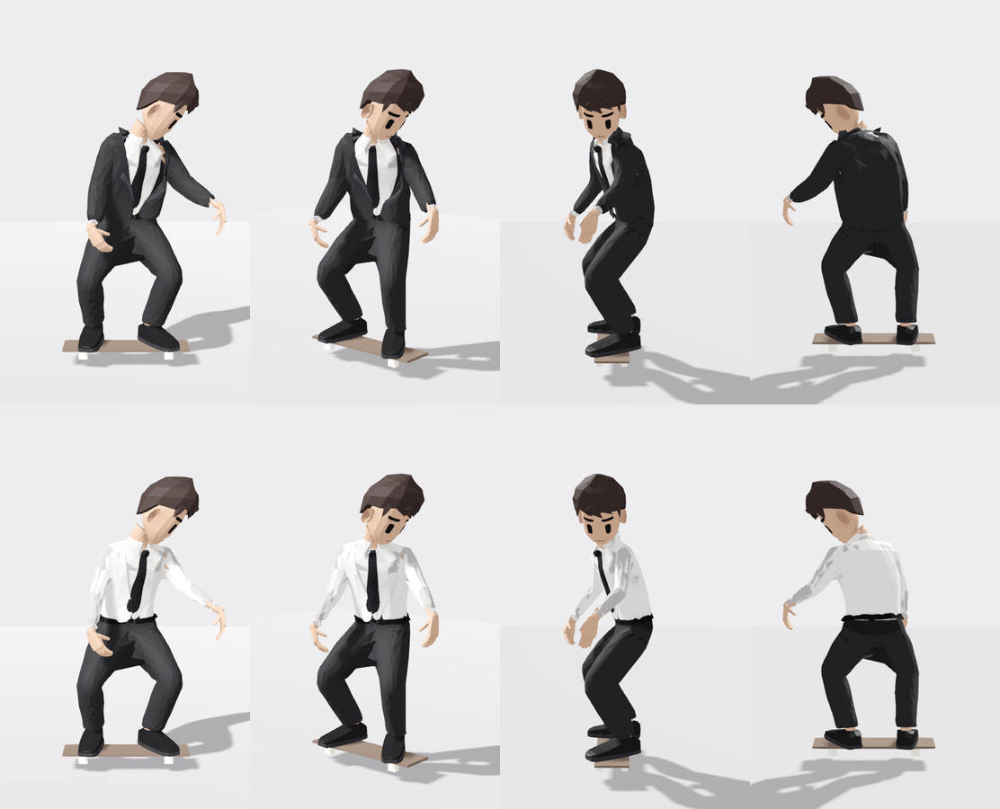

# The Suit Man



One file, **`suitman.glb`**: its body (23,827 vertices, 9,424 triangles, 1 texture; materials
`M_Fabric`, `M_Fabric`, `M_Fabric`, `M_Skin`, `M_Fabric`, `M_Skin`, `M_Skin`, `M_Skin`, `M_Fabric`, `M_Fabric`, `M_Leather`, `M_Hair`, `M_Skin`, `M_Leather`, `M_Skin`, `M_Rubber`, `M_Fabric`, `M_Paint`, `M_Metal`, `M_Skin`, `M_Fabric`, `M_Fabric`, `M_Fabric`, `M_Skin`), a 52-bone Mixamo-named skeleton, and our **14 skate moves already on its own skeleton**, with the
skateboard animated per trick. Nothing to retarget: put it in a project and play `z_rm_sk_ride`.

## Its wardrobe

Every piece of clothing (and each hairstyle) is its own mesh on the one skeleton, tagged in its name -- `wear~<slot>~<piece>~<outfits>`, and `skin~h=<pieces>` for the skin those pieces cover (hidden while one is worn: nothing pokes through, nothing is missing without it). Built by the club's tailor (`skate_src/reva902/atelier.py`; the design: `design/atelier.md`).

| outfit | pieces (slot) |
|---|---|
| **suit** | `trousers` (legs), `jacket` (outer), `shirt` (top), `lapels` (lapels), `tie` (tie), `belt` (belt), `hair` (hair), `shoes` (feet), `face` (face), `collar` (collar), `knot` (tie), `jcollar` (jcollar) |
| **shirtsleeves** | `trousers` (legs), `shirt` (top), `tie` (tie), `belt` (belt), `hair` (hair), `shoes` (feet), `face` (face), `collar` (collar), `knot` (tie) |

## Use it

1. Copy `suitman.glb` **and `suitman.glb.import`** into your project (the `.import` carries the settings below).
2. ⛔ Godot's animation **optimizer** is a setting of the `AnimationPlayer` NODE (*Advanced Import Settings* →
   `AnimationPlayer` → *Optimizer* off) -- on, it drops keys and the pose drifts 1-3 mm. This `.import` has it off.
3. Instance it and play **`z_rm_sk_ride`** (loop). Move the ROOT along your path with the board's nose (+X) along
   the travel. A trick is a one-shot that starts and ends in the riding stance: `play("z_rm_sk_kf")` then
   `queue("z_rm_sk_ride")`. The moves: `godot/ANIMATION_IMPORT.md` → *The moves*.
4. The `skateboard` node is a sibling of the skeleton, animated in its own space: origin = the deck top's centre,
   +X the nose, +Y up. Parent a real board under it and hide the generated deck.
6. **Its wardrobe:** `var w := ClubWardrobe.attach(instance, "suit")` (`godot/characters/club_wardrobe.gd`), then `w.wear_outfit("shirtsleeves")`, `w.take_off("<piece>")`, `w.put_on("<piece>")` (it replaces whatever filled that slot). Without it every piece shows at once.

## What it is

- **1.76 m** tall; metres, Y up, facing +Z. 52 bones.
- Moves: `z_rm_sk_carry`, `z_rm_sk_catchup`, `z_rm_sk_dropin`, `z_rm_sk_stepoff`, `z_rm_sk_bail`, `z_rm_sk_grab`, `z_rm_sk_method`, `z_rm_sk_push`, `z_rm_sk_pop`, `z_rm_sk_kf`, `z_rm_sk_shove`, `z_rm_sk_manual`, `z_rm_sk_ride`, `z_rm_sk_film`.

## Verified (2026-09-29, by `skate_src/author/ship_character.py`)

- Blender re-read this file: every joint of every move within **1 µm**, every vertex of the body within
  **1 µm** of the club engine's own skinning (`godot/verify_export_blender.py`).
- Godot 4.7.2: every joint and the board within **1 µm** on 4 moves (`demo/check_pose.gd` + `check_pose_compare.py`).

## Rebuild it

Built by code: `skate_src/suitman/build_suitman.py` (see its header for the command). Then:

```bash
python skate_src/author/ship_character.py suitman --glb <its rigged .glb>
```
