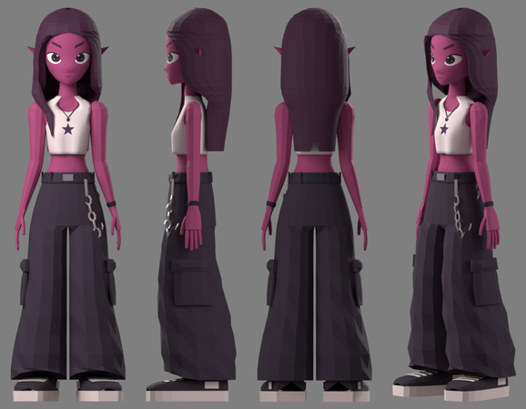

# X3D -- the skater girl, ready for Godot 4




jacob's second character: a stylised low-poly girl -- magenta skin, long straight plum hair with a lock falling over her right shoulder, pointed elf ears, huge winged eyes, a cream crop tank with a dark star, very wide black cargo pants with a wallet chain, chunky skate shoes. Built entirely by code from his character sheet: she bends (one skin per part, blended weights) where Clanker is rigid.

One file, **`x3d.glb`**: its body (13,844 vertices, 8,752 triangles, 1 texture; materials
`M_Hair`, `M_Skin`, `M_Pants`, `M_Chain`, `M_Top`, `M_Shoe`, `M_Belt`, `M_Band`, `M_Sole`, `M_Metal`), a 68-bone Mixamo-named skeleton, and our **14 skate moves already on its own skeleton**, with the
skateboard animated per trick. Nothing to retarget: put it in a project and play `z_rm_sk_ride`. Its hair carries 4 physics chains (`Hair_Lock_R1..4`, `Hair_Back_L1..4`, `Hair_Back_C1..4`, `Hair_Back_R1..4`): the club engine swings them, and in Godot one line does -- `ClubHair.attach(instance)` (`godot/characters/club_hair.gd`).

## Use it

1. Copy `x3d.glb` **and `x3d.glb.import`** into your project (the `.import` carries the settings below).
2. ⛔ Godot's animation **optimizer** is a setting of the `AnimationPlayer` NODE (*Advanced Import Settings* →
   `AnimationPlayer` → *Optimizer* off) -- on, it drops keys and the pose drifts 1-3 mm. This `.import` has it off.
3. Instance it and play **`z_rm_sk_ride`** (loop). Move the ROOT along your path with the board's nose (+X) along
   the travel. A trick is a one-shot that starts and ends in the riding stance: `play("z_rm_sk_kf")` then
   `queue("z_rm_sk_ride")`. The moves: `godot/ANIMATION_IMPORT.md` → *The moves*.
4. The `skateboard` node is a sibling of the skeleton, animated in its own space: origin = the deck top's centre,
   +X the nose, +Y up. Parent a real board under it and hide the generated deck.
5. **Hair physics:** `ClubHair.attach(instance)` after instancing it (Godot 4.4+'s SpringBoneSimulator3D, world space; `stiffness`, `drag`, `gravity` are its arguments).

## What it is

- **1.66 m** tall; metres, Y up, facing +Z. 68 bones.
- Moves: `z_rm_sk_carry`, `z_rm_sk_catchup`, `z_rm_sk_dropin`, `z_rm_sk_stepoff`, `z_rm_sk_bail`, `z_rm_sk_grab`, `z_rm_sk_method`, `z_rm_sk_push`, `z_rm_sk_pop`, `z_rm_sk_kf`, `z_rm_sk_shove`, `z_rm_sk_manual`, `z_rm_sk_ride`, `z_rm_sk_film`.

## Verified (2026-09-27, by `skate_src/author/ship_character.py`)

- Blender re-read this file: every joint of every move within **1 µm**, every vertex of the body within
  **1 µm** of the club engine's own skinning (`godot/verify_export_blender.py`).
- Godot 4.7.2: every joint and the board within **1 µm** on 4 moves (`demo/check_pose.gd` + `check_pose_compare.py`).

## Rebuild it

Built by code: `skate_src/x3d/build_x3d.py` (see its header for the command). Then:

```bash
python skate_src/author/ship_character.py x3d --glb <its rigged .glb>
```
